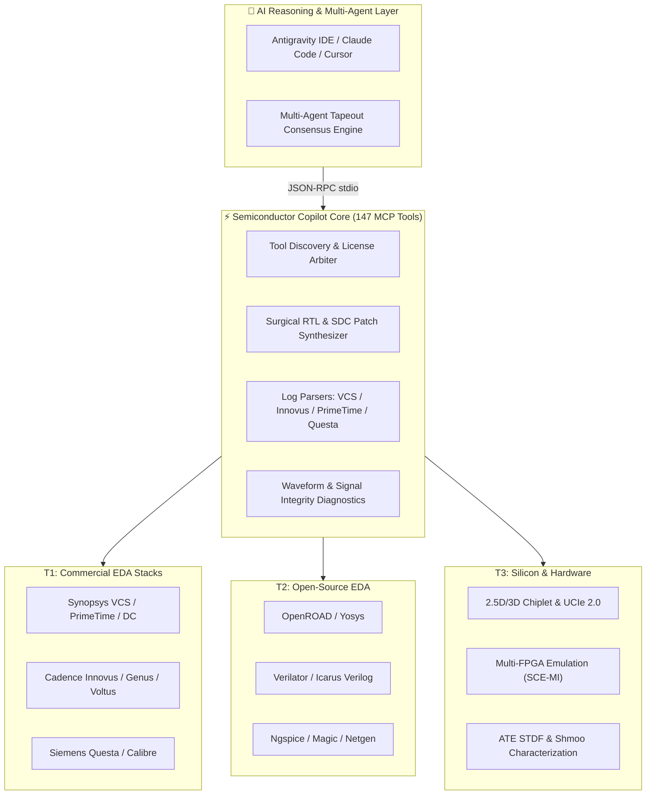

<div align="center">

<!-- ======================================================== -->
<!-- 🌌 3D WAVING GRADIENT ANIMATED HEADER (CAPSULE RENDER)    -->
<!-- ======================================================== -->


<!-- ======================================================== -->
<!-- ⚡ MULTILINGUAL ANIMATED TYPING SVG                      -->
<!-- ======================================================== -->
<a href="#-tiếng-việt">
  
</a>

<!-- ======================================================== -->
<!-- 🌐 DUAL-LANGUAGE SWITCHER (CHỌN NGÔN NGỮ)                 -->
<!-- ======================================================== -->
<p align="center">
  <a href="#-tiếng-việt">
    
  </a>
  &nbsp;&nbsp;
  <a href="#-english">
    
  </a>
</p>

<!-- ======================================================== -->
<!-- 💎 3D SHIELDS & BADGES MATRIX                            -->
<!-- ======================================================== -->
<p align="center">
  
  
  
  
  
  
</p>

<p align="center">
  <b>Kiến trúc Kỹ thuật Vi mạch AI Bán dẫn Cấp Doanh nghiệp & Nghiên cứu Đỉnh cao</b><br/>
  <i>Cầu nối mô hình trí tuệ nhân tạo (LLM/Agent) với chuỗi công cụ EDA chuẩn công nghiệp: Synopsys, Cadence, Siemens, OpenROAD, Yosys, Verilator</i>
</p>

---

<!-- ======================================================== -->
<!-- 📑 TABLE OF CONTENTS (MỤC LỤC ĐIỀU HƯỚNG NHANH)          -->
<!-- ======================================================== -->
<table align="center">
  <tr>
    <td align="center"><b>🇻🇳 Tiếng Việt</b></td>
    <td align="center"><b>🇺🇸 English</b></td>
    <td align="center"><b>⚡ Tài Nguyên / Resources</b></td>
  </tr>
  <tr>
    <td>
      • <a href="#-1-tổng-quan--tầm-nhìn-zero-hallucination">Tầm nhìn Zero-Hallucination</a><br/>
      • <a href="#-2-kiến-trúc-hệ-thống-3-tầng">Kiến trúc Hệ thống 3 Tầng</a><br/>
      • <a href="#-3-10-trụ-cột-năng-lực-v50-100-tính-năng-đỉnh-cao">10 Trụ cột Năng lực V5.0</a><br/>
      • <a href="#-4-hướng-dẫn-cài-đặt--chạy-nhanh">Hướng dẫn Cài đặt & Chạy nhanh</a>
    </td>
    <td>
      • <a href="#-1-vision--the-zero-hallucination-silicon-shield">Vision & Zero-Hallucination</a><br/>
      • <a href="#-2-architectural-blueprint--multi-tier-execution">Architectural Blueprint</a><br/>
      • <a href="#-3-v50-engineering-domains--100-new-capabilities">V5.0 Engineering Domains</a><br/>
      • <a href="#-4-quick-start--mcp-server-integration">Quick Start & MCP Setup</a>
    </td>
    <td>
      • <a href="#-ma-trận-147-công-cụ-eda-mcp-core-tools-matrix">147 MCP Core Tools Matrix</a><br/>
      • <a href="#-bằng-chứng-kiểm-thử-thực-tế-verification-evidence">Bằng chứng Kiểm thử (364 Tests)</a><br/>
      • <a href="#-tài-liệu-chi-tết-deep-dive-documentation">Tài liệu Chi tiết (Deep Dive Docs)</a><br/>
      • <a href="#-công-nghệ--tech-stack">Tech Stack & Ecosystem</a>
    </td>
  </tr>
</table>

---

</div>

<br/>

<!-- ======================================================================= -->
<!-- ==================== 🇻🇳 PHẦN TIẾNG VIỆT ============================== -->
<!-- ======================================================================= -->

# 🇻🇳 TIẾNG VIỆT

## 🌟 1. Tổng Quan & Tầm Nhìn "Zero-Hallucination"

Một lần băng đồng (tape-out) vi mạch hiện đại có chi phí từ vài triệu đến hàng chục triệu USD. Chỉ một sai số xung nhịp nhỏ (timing slack ảo) hoặc một điểm nghẽn xung nhịp chưa được đồng bộ (CDC glitch) cũng có thể làm silicon hỏng hoàn toàn, gây tổn thất hàng triệu USD tiền đúc chip lại (respin).

**Semiconductor Engineering Copilot V5.0** được thiết kế dưới triết lý **Triad Skill Stack** nghiêm ngặt:
1. 🛡️ **Giao thức REA (Evidence First - Không chứng cứ, không khẳng định)**: Tuyệt đối không phỏng đoán kết quả mô phỏng, độ trễ đóng gói hay kiểm tra quy tắc vật lý DRC. Mọi kết luận timing ($WNS \ge 0.000\,\text{ns}$), suy hao mắt PAM4 hay pass DRC/LVS đều phải được bảo chứng bằng mã thoát (exit code), trích xuất dòng log thực tế kèm checksum.
2. ✂️ **Thang Tối Giản Ponytail (Minimality Ladder)**: Can thiệp mã nguồn phẫu thuật chính xác tuyệt đối. Không viết lại toàn bộ RTL đang chạy khi xử lý ECO timing closure. Tuân thủ thứ bậc: *YAGNI ➔ Tái sử dụng Codebase ➔ Stdlib ➔ One-Liner ➔ Diff tối thiểu*.
3. 🔒 **Pháo Đài Bảo Mật PDK (Confidentiality Shield)**: Tuyệt đối không rò rỉ tập tin PDK độc quyền của foundry (TSMC, Intel, Samsung), DRC decks, GDSII hay mã nguồn RTL độc quyền của khách hàng ra các dịch vụ AI công cộng trái phép.

---

## 🏗️ 2. Kiến Trúc Hệ Thống 3 Tầng

Hệ thống kết nối trực tiếp mô hình ngôn ngữ lớn (LLM Agent) với các phần mềm EDA tiêu chuẩn công nghiệp thông qua giao thức mở **Model Context Protocol (MCP)**:

```
       ╔═══════════════════════════════════════════════════════════════════════╗
       ║                  Lớp Suy Luận & Tác Tử Trí Tuệ Nhân Tạo               ║
       ║          (Claude Code / Cursor / Windsurf / Antigravity IDE)          ║
       ╚══════════════════════════════════╦════════════════════════════════════╝
                                          ║ (Giao thức JSON-RPC 2.0 stdio)
       ╔══════════════════════════════════╩════════════════════════════════════╗
       ║          LÕI ĐIỀU PHỐI SEMICONDUCTOR COPILOT (147 CÔNG CỤ EDA)        ║
       ║  ┌────────────────────────┬────────────────────────┬────────────────┐ ║
       ║  │ 🔬 Pha Thấu Hiểu (EDA) │ 📐 Pha Lập Kế Hoạch    │ ⚡ Pha Thực Thi │ ║
       ║  │ 🔍 Bộ Bóc Tách Parsers │ 🛠️ Vá Mã Nguồn ECO    │ ✅ Thẩm Định   │ ║
       ║  └────────────────────────┴────────────────────────┴────────────────┘ ║
       ╚══════════════════════════════════╦════════════════════════════════════╝
                                          ║
          ┌───────────────────────────────┼───────────────────────────────┐
          ▼                               ▼                               ▼
╔═══════════════════╗           ╔═══════════════════╗           ╔═══════════════════╗
║ Tầng 1: MCP Core  ║           ║ Tầng 2: Commercial║           ║ Tầng 3: Open EDA  ║
║ Native JSON-RPC   ║           ║ Tcl Batch Shells  ║           ║ Mã Nguồn Mở       ║
║ 147 Tool Schemas  ║           ║ Synopsys PrimeTime║           ║ OpenROAD, Yosys,  ║
║ Node.js / Python  ║           ║ Cadence Innovus   ║           ║ Verilator, Icarus,║
║ Stdio Pipe Server ║           ║ Siemens Questa    ║           ║ Ngspice, Magic    ║
╚═══════════════════╝           ╚═══════════════════╝           ╚═══════════════════╝
```

---

## ⚡ 3. 10 Trụ Cột Năng Lực V5.0 (100 Tính Năng Đỉnh Cao)

Phiên bản V5.0 nâng tổng số năng lực sản xuất của nền tảng lên **447 tính năng**, bổ sung 100 năng lực mũi nhọn được tổ chức trong 10 phân hệ chuyên sâu:

| Phân Hệ | Lĩnh Vực Trọng Tâm | Các Tính Năng Then Chốt | Tệp Nguồn Triển Khai |
| :---: | :--- | :--- | :--- |
| **01** | **Chiplet & Đóng Gói 2.5D/3D** | Thẩm định giao thức UCIe 1.1/2.0, định tuyến D2D, kiểm tra khoảng cách microbump, dự đoán cong vênh interposer, ứng suất nhiệt TSV, đồng tối ưu PDN đa die | [`modules/v5/chiplet-pkg/v5_chiplet_arch.js`](file:///c:/Users/Hoang/Desktop/New%20folder/SKILL-Semiconductor--b-n-d-n/semiconductor-engineering-copilot/modules/v5/chiplet-pkg/v5_chiplet_arch.js) |
| **02** | **Vi Kiến Trúc CPU, GPU & NPU** | Bộ tổng hợp lệnh mở rộng RISC-V tùy biến, kiểm toán hàng đợi OoO ROB, dự đoán rẽ nhánh branch predictor, kiểm tra tính nhất quán bộ nhớ MESI, warp divergence SIMT | [`modules/v5/chiplet-pkg/v5_chiplet_arch.js`](file:///c:/Users/Hoang/Desktop/New%20folder/SKILL-Semiconductor--b-n-d-n/semiconductor-engineering-copilot/modules/v5/chiplet-pkg/v5_chiplet_arch.js) |
| **03** | **Giao Tiếp Tốc Độ Cao & Signal Integrity** | Phân tích mắt PAM4 PCIe Gen 6/7, tự động cân bằng SerDes CTLE/DFE, kiểm tra tính nhân quả ma trận S-parameter, phân rã Jitter, margining DDR5/LPDDR5X, suy hao HBM3e | [`modules/v5/hs-interfaces/v5_hs_thermal.js`](file:///c:/Users/Hoang/Desktop/New%20folder/SKILL-Semiconductor--b-n-d-n/semiconductor-engineering-copilot/modules/v5/hs-interfaces/v5_hs_thermal.js) |
| **04** | **Nhiệt Học, Độ Tin Cậy & Lão Hóa** | Mô phỏng điểm nóng nhiệt chuyển tiếp, tính toán Black equation EM/SHE, suy giảm ngưỡng điện áp BTI/HCI, đánh thủng điện môi TDDB, chuẩn ô tô AEC-Q100 | [`modules/v5/hs-interfaces/v5_hs_thermal.js`](file:///c:/Users/Hoang/Desktop/New%20folder/SKILL-Semiconductor--b-n-d-n/semiconductor-engineering-copilot/modules/v5/hs-interfaces/v5_hs_thermal.js) |
| **05** | **Giả Lập Multi-FPGA & Kiểm Thử Phần Cứng** | Phân vùng logic đa FPGA, đồng mô phỏng lai chuẩn SCE-MI, bộ điều chỉnh tốc độ ICE speedbridge, tối ưu độ trễ cáp TDM, probe ILA động, phân tích JTAG scan dump | [`modules/v5/emu-fpga/v5_emu_ai_eda.js`](file:///c:/Users/Hoang/Desktop/New%20folder/SKILL-Semiconductor--b-n-d-n/semiconductor-engineering-copilot/modules/v5/emu-fpga/v5_emu_ai_eda.js) |
| **06** | **Nghiên Cứu AI Cho EDA (AI-Assisted EDA)** | Xếp macro bằng học tăng cường sâu DRL, dự đoán nghẽn dây qua GNN, tự định vị lỗi và vá Verilog tự động bằng LLM, mạng nơ-ron vật lý PINN dự đoán sụt áp IR-drop | [`modules/v5/emu-fpga/v5_emu_ai_eda.js`](file:///c:/Users/Hoang/Desktop/New%20folder/SKILL-Semiconductor--b-n-d-n/semiconductor-engineering-copilot/modules/v5/emu-fpga/v5_emu_ai_eda.js) |
| **07** | **Vòng Đời IP & Dữ Liệu Thiết Kế** | Đóng gói IP-XACT IEEE 1685-2022, phát hiện thay đổi semver phá vỡ giao diện RTL, tự động chèn cổng spare ECO netlist, thủy vân số bảo mật HMAC, niêm phong OASIS/GDSII | [`modules/v5/data-ip/v5_data_silicon.js`](file:///c:/Users/Hoang/Desktop/New%20folder/SKILL-Semiconductor--b-n-d-n/semiconductor-engineering-copilot/modules/v5/data-ip/v5_data_silicon.js) |
| **08** | **Đo Kiểm Silicon & Mang Chip Lên Hoạt Động** | Vẽ biểu đồ Shmoo Plot (điện áp - tần số - nhiệt độ), phân tích dữ liệu máy đo ATE STDF, định vị khuyết tật scan callout, giám định năng lực quy trình SPC Cp/Cpk (>1.33) | [`modules/v5/data-ip/v5_data_silicon.js`](file:///c:/Users/Hoang/Desktop/New%20folder/SKILL-Semiconductor--b-n-d-n/semiconductor-engineering-copilot/modules/v5/data-ip/v5_data_silicon.js) |
| **09** | **Đồng Thiết Kế Phần Cứng & Phần Mềm (HW/SW)** | Định tuyến giao dịch SystemC TLM-2.0, đồng bộ bản đồ thanh ghi CSR sang C/SystemVerilog, tạo thư viện HAL bare-metal, đồng tương quan vết Gem5, bắt tay secure boot | [`modules/v5/sys-codesign/v5_sys_release.js`](file:///c:/Users/Hoang/Desktop/New%20folder/SKILL-Semiconductor--b-n-d-n/semiconductor-engineering-copilot/modules/v5/sys-codesign/v5_sys_release.js) |
| **10** | **QA Tự Hành & Cổng Ký Duyệt Băng Đồng** | Ma trận truy xuất từ đặc tả đến kiểm thử, khử trùng lặp lỗi lint tĩnh, so sánh delta sai hỏng mô phỏng, chọn lọc ca kiểm thử theo ảnh hưởng diff, phán quyết cổng tapeout | [`modules/v5/sys-codesign/v5_sys_release.js`](file:///c:/Users/Hoang/Desktop/New%20folder/SKILL-Semiconductor--b-n-d-n/semiconductor-engineering-copilot/modules/v5/sys-codesign/v5_sys_release.js) |

---

## 🚀 4. Hướng Dẫn Cài Đặt & Chạy Nhanh

### Bước 1: Khám Phá Môi Trường EDA Sẵn Có
Kiểm tra tự động hơn 20 phần mềm vi mạch và các biến môi trường bản quyền (`LM_LICENSE_FILE`, `SNPSLMD_LICENSE_FILE`):
```bash
node semiconductor-engineering-copilot/scripts/discover_tools.js
node semiconductor-engineering-copilot/scripts/validate_environment.js
```

### Bước 2: Chạy Bộ Kiểm Thử Hồi Quy Toàn Diện (364 Tests)
```bash
# Kiểm tra nhanh tính hợp lệ của skill vi mạch
node semiconductor-engineering-copilot/scripts/validate_skill.js

# Chạy toàn bộ 100 bài kiểm thử V5.0
node semiconductor-engineering-copilot/tests/unit/run_all_v5_tests.js

# Chạy kiểm thử khói (Smoke Test) và E2E
node semiconductor-engineering-copilot/tests/smoke/run_v5_smoke_tests.js
node semiconductor-engineering-copilot/tests/e2e/run_v5_e2e_tests.js

# Chạy toàn bộ hồi quy 147 công cụ EDA
node semiconductor-engineering-copilot/tests/run_tests.js
```

### Bước 3: Cấu Hình Tích Hợp Máy Chủ MCP
Thêm cấu hình sau vào tệp cấu hình tác tử (`mcp_config.json` hoặc cấu hình Claude / Cursor / Antigravity):
```json
{
  "mcpServers": {
    "semiconductor-copilot": {
      "command": "node",
      "args": [
        "semiconductor-engineering-copilot/adapters/mcp/eda_mcp_server.js"
      ],
      "env": {
        "SEMICONDUCTOR_WORKSPACE_ROOT": "."
      }
    }
  }
}
```

<br/>

<!-- ======================================================================= -->
<!-- ==================== 🇺🇸 ENGLISH SECTION ============================= -->
<!-- ======================================================================= -->

# 🇺🇸 ENGLISH

## 🌌 1. Vision & The "Zero-Hallucination" Silicon Shield

Modern semiconductor tape-outs cost upwards of tens of millions of dollars. A single hallucinated clock-domain crossing (CDC) synchronizer, an overlooked setup violation, or a flawed S-parameter passivity assumption can render an entire wafer lot non-functional.

**Semiconductor Engineering Copilot V5.0** operates under an uncompromising **Triad Execution Stack**:
1. 🛡️ **REA Evidence Protocol**: Zero assumptions. Timing closures ($WNS \ge 0.000\,\text{ns}$), DRC/LVS clean status, and UVM pass metrics are validated against deterministic exit codes, raw stdout log lines, and regex-anchored signatures.
2. ✂️ **Ponytail Minimality Ladder**: Surgical code synthesis. Never rewrite functional golden RTL during post-route ECO loops. Always climb the ladder: *YAGNI ➔ Codebase Reuse ➔ Stdlib ➔ One-Liner ➔ Minimum Viable Diff*.
3. 🔒 **Confidentiality Fortress**: Proprietary foundry PDKs (TSMC, Intel, Samsung), DRC decks, GDSII layouts, and customer RTL are cryptographically protected and never exfiltrated to public third-party LLMs.

---

## 💎 2. Architectural Blueprint & Multi-Tier Execution

The architecture seamlessly bridges frontier AI reasoning agents with industry-standard commercial and open-source EDA engines using the **Model Context Protocol (MCP)**:



---

## ⚡ 3. V5.0 Engineering Domains (100 New Capabilities)

Version 5.0 brings the total platform footprint to **447 production-grade capabilities**, incorporating 100 frontier features organized into 10 explicit groups:

| Group | Focus Domain | Key Capabilities | Implementation File |
| :---: | :--- | :--- | :--- |
| **01** | **Chiplet & Advanced Packaging** | UCIe 1.1/2.0 protocol validation, D2D interconnect routing, microbump pitch rules, interposer warpage modeling, TSV stress analysis, multi-die PDN co-optimization | [`modules/v5/chiplet-pkg/v5_chiplet_arch.js`](file:///c:/Users/Hoang/Desktop/New%20folder/SKILL-Semiconductor--b-n-d-n/semiconductor-engineering-copilot/modules/v5/chiplet-pkg/v5_chiplet_arch.js) |
| **02** | **CPU, GPU & NPU Architecture** | RISC-V custom instruction synthesizer, OoO ROB scheduler auditor, branch predictor profiler, MESI coherence formal verifier, SIMT warp divergence, Tensor GEMM evaluator | [`modules/v5/chiplet-pkg/v5_chiplet_arch.js`](file:///c:/Users/Hoang/Desktop/New%20folder/SKILL-Semiconductor--b-n-d-n/semiconductor-engineering-copilot/modules/v5/chiplet-pkg/v5_chiplet_arch.js) |
| **03** | **High-Speed Interfaces & SI** | PCIe Gen 6/7 PAM4 eye analyzer, SerDes CTLE/DFE adaptive equalizer, S-parameter causality/passivity checker, jitter decomposition, DDR5/LPDDR5X margining, HBM3e loss | [`modules/v5/hs-interfaces/v5_hs_thermal.js`](file:///c:/Users/Hoang/Desktop/New%20folder/SKILL-Semiconductor--b-n-d-n/semiconductor-engineering-copilot/modules/v5/hs-interfaces/v5_hs_thermal.js) |
| **04** | **Thermal, Reliability & Aging** | Transient thermal hotspot simulation, Black equation EM/SHE sign-off, BTI Vth shift degradation, HCI gate oxide predictor, TDDB lifetime, AEC-Q100 Grade 0-3 | [`modules/v5/hs-interfaces/v5_hs_thermal.js`](file:///c:/Users/Hoang/Desktop/New%20folder/SKILL-Semiconductor--b-n-d-n/semiconductor-engineering-copilot/modules/v5/hs-interfaces/v5_hs_thermal.js) |
| **05** | **Emulation & Hardware Validation** | Multi-FPGA partitioning, SCE-MI hybrid co-emulation, ICE speedbridge FIFO adapter, TDM cable latency optimizer, dynamic ILA probing, post-silicon JTAG scan dumps | [`modules/v5/emu-fpga/v5_emu_ai_eda.js`](file:///c:/Users/Hoang/Desktop/New%20folder/SKILL-Semiconductor--b-n-d-n/semiconductor-engineering-copilot/modules/v5/emu-fpga/v5_emu_ai_eda.js) |
| **06** | **AI-Assisted EDA Research** | DRL macro placer, GNN wire congestion estimator, LLM Verilog bug localizer & auto-patcher, transfer learning post-route timing metamodeling, PINN IR-drop estimator | [`modules/v5/emu-fpga/v5_emu_ai_eda.js`](file:///c:/Users/Hoang/Desktop/New%20folder/SKILL-Semiconductor--b-n-d-n/semiconductor-engineering-copilot/modules/v5/emu-fpga/v5_emu_ai_eda.js) |
| **07** | **Design Data & IP Lifecycle** | IP-XACT IEEE 1685-2022 component packaging, RTL semantic breaking change detector, automated ECO netlist patcher, zero-overhead HMAC IP watermarking, OASIS tapeout seal | [`modules/v5/data-ip/v5_data_silicon.js`](file:///c:/Users/Hoang/Desktop/New%20folder/SKILL-Semiconductor--b-n-d-n/semiconductor-engineering-copilot/modules/v5/data-ip/v5_data_silicon.js) |
| **08** | **Silicon Validation & Test** | Automated V-F-T Shmoo plot characterization, ATE STDF record parser, scan callout defect localization, SPC Cp/Cpk yield sentinel (>1.33), wafer probe map spatial clustering | [`modules/v5/data-ip/v5_data_silicon.js`](file:///c:/Users/Hoang/Desktop/New%20folder/SKILL-Semiconductor--b-n-d-n/semiconductor-engineering-copilot/modules/v5/data-ip/v5_data_silicon.js) |
| **09** | **HW/SW Co-Design** | SystemC TLM-2.0 transaction router, CSR C/SystemVerilog synchronizer, bare-metal HAL generator, Gem5 trace correlation, secure boot RoT cryptographic handshake | [`modules/v5/sys-codesign/v5_sys_release.js`](file:///c:/Users/Hoang/Desktop/New%20folder/SKILL-Semiconductor--b-n-d-n/semiconductor-engineering-copilot/modules/v5/sys-codesign/v5_sys_release.js) |
| **10** | **Autonomous QA & Release** | Spec-to-verification traceability matrix, static diagnostic deduplicator, simulation regression delta comparator, surgical test impact selector, production tapeout gate arbiter | [`modules/v5/sys-codesign/v5_sys_release.js`](file:///c:/Users/Hoang/Desktop/New%20folder/SKILL-Semiconductor--b-n-d-n/semiconductor-engineering-copilot/modules/v5/sys-codesign/v5_sys_release.js) |

---

## 🛠️ 4. Quick Start & MCP Server Integration

### Step 1: Discover Available Toolchains & Licenses
```bash
node semiconductor-engineering-copilot/scripts/discover_tools.js
node semiconductor-engineering-copilot/scripts/validate_environment.js
```

### Step 2: Run Full Multi-Tier Test Suites (364 Tests Clean)
```bash
# Validate skill directory integrity
node semiconductor-engineering-copilot/scripts/validate_skill.js

# Execute 100 V5.0 unit tests
node semiconductor-engineering-copilot/tests/unit/run_all_v5_tests.js

# Execute smoke & cross-module E2E test suites
node semiconductor-engineering-copilot/tests/smoke/run_v5_smoke_tests.js
node semiconductor-engineering-copilot/tests/e2e/run_v5_e2e_tests.js

# Execute full 147 EDA tool contract regression
node semiconductor-engineering-copilot/tests/run_tests.js
```

### Step 3: Register MCP Server in Your AI Agent
Add to `mcp_config.json` (or settings in Claude Code, Cursor, Windsurf, or Antigravity):
```json
{
  "mcpServers": {
    "semiconductor-copilot": {
      "command": "node",
      "args": [
        "semiconductor-engineering-copilot/adapters/mcp/eda_mcp_server.js"
      ],
      "env": {
        "SEMICONDUCTOR_WORKSPACE_ROOT": "."
      }
    }
  }
}
```

<br/>

<!-- ======================================================================= -->
<!-- ==================== 📊 COMPREHENSIVE TOOLS & EVIDENCE ================ -->
<!-- ======================================================================= -->

# 📊 Ma Trận 147 Công Cụ EDA (MCP Core Tools Matrix)

<details open>
<summary><b>🔹 Giai Đoạn 1: RTL Cốt Lõi, Tổng Hợp Logic & Kiểm Tra Timing Cơ Bản (Công cụ 1–17)</b></summary>
<br/>

| Icon | Tên Công Cụ | Phạm Vi & Năng Lực Chi Tiết |
| :---: | :--- | :--- |
| 🔍 | `discover_eda_tools` | Quét hệ thống tự động, nhận diện 20+ phần mềm EDA, kiểm tra biến môi trường license (`LM_LICENSE_FILE`, `SNPSLMD_LICENSE_FILE`). |
| 📂 | `inspect_project` | Khảo sát cây thư mục dự án vi mạch tìm kiếm `.v`, `.sv`, `.sdc`, `.xdc`, `.tcl`, `.vcd` và build manifests. |
| 📖 | `read_rtl_source` | Đọc an toàn mã nguồn RTL có giới hạn token, lập chỉ mục symbol và phân tích cú pháp theo vùng. |
| 🧹 | `lint_rtl` | Kiểm tra khả năng tổng hợp (synthesizability), lint cú pháp (Verilator, slang, Veridian), phát hiện chốt (latch). |
| 🌳 | `elaborate_design` | Mở rộng cấu trúc phân cấp module đỉnh (top-level), phát hiện lệch cổng và dây chưa đấu nối. |
| 🏃 | `run_simulation` | Thực thi mô phỏng headless qua VCS, Questa, Xcelium, Icarus Verilog và Verilator. |
| 🎲 | `run_regression` | Bộ chạy hồi quy giả ngẫu nhiên đa hạt giống (multi-seed), tổng hợp tỷ lệ pass/fail và chữ ký lỗi. |
| 📋 | `inspect_simulation_logs` | Bóc tách log mô phỏng thô tìm `UVM_FATAL`, `UVM_ERROR` và lỗi assertion kèm timestamp. |
| 🌊 | `inspect_waveform` | Phân tích biến thiên giá trị tín hiệu, tiêm trạng thái X và phát hiện xung nhọn glitch trên file VCD/FST. |
| 📊 | `analyze_coverage` | Bóc tách cơ sở dữ liệu độ bao phủ (coverage): statement, branch, toggle, expression và functional coverage. |
| ⚙️ | `run_synthesis` | Tổng hợp netlist mức cổng (gate-level) nhắm tới thư viện chuẩn công nghiệp hoặc công nghệ mở (Yosys, DC, Genus). |
| ⏱️ | `analyze_timing_report` | Phân tích báo cáo STA, trích xuất WNS, TNS, WHS, THS và các điểm mút đường tới hạn (critical path). |
| 🔎 | `inspect_critical_paths` | Bóc tách hình nón logic, phân rã trễ cổng vs trễ dây, trích xuất điểm nghẽn đường fanout cao. |
| 📐 | `inspect_physical_design_reports` | Bóc tách báo cáo DRC, LVS và bản đồ mật độ nghẽn dây (Innovus, ICC2, OpenROAD). |
| 🧪 | `generate_testbench` | Tự động sinh môi trường kiểm thử SystemVerilog/UVM 1.2 chuẩn (Driver, Monitor, Agent, Scoreboard). |
| 🩹 | `propose_rtl_patch` | Xuất file diff phẫu thuật sửa vi phạm timing hoặc lỗi logic mà không gây hồi quy (regression). |
| 🎯 | `validate_patch` | Thực thi lại mô phỏng hoặc STA mục tiêu chứng minh sự cố đã được giải quyết triệt để. |

</details>

<details>
<summary><b>🔹 Giai Đoạn 2: RTL Nâng Cao, UVM & Tự Động Hóa Ký Duyệt Sign-off (Công cụ 18–47)</b></summary>
<br/>

| Icon | Tên Công Cụ | Phạm Vi & Năng Lực Chi Tiết |
| :---: | :--- | :--- |
| 🔀 | `cdc_lint_analyzer` | Phát hiện miền xung nhịp bất đồng bộ, lệch bus đa bit và rủi ro hội tụ tín hiệu qua các clock domain. |
| 📦 | `axi_packet_generator` | Tạo module Master/Slave AXI4/AXI-Stream với kiểm tra biên 4KB và phòng chống deadlock bắt tay. |
| 🔄 | `fsm_optimizer_checker` | Kiểm chứng hình thức FSM, phát hiện trạng thái treo và mã hóa an toàn Hamming/Gray/One-Hot. |
| 💾 | `memory_bist_wrapper_gen` | Sinh lớp bọc MBIST kiểm thử bộ nhớ SRAM giải thuật March-C+ kèm muxing và chế độ lưu dữ liệu. |
| 💡 | `clock_gating_optimizer` | Phát hiện vòng lặp phản hồi thanh ghi và tự động chèn cổng Integrated Clock Gating (ICG). |
| ⏩ | `register_slice_generator` | Sinh skid buffer trễ 2 bước (forward/backward/full) cắt đứt đường timing dài mà không mất băng thông. |
| 📚 | `uvm_ral_model_gen` | Tự động sinh khối thanh ghi UVM Register Abstraction Layer (RAL) và adapter backdoor từ file map JSON. |
| ⚖️ | `formal_property_prover` | Tổng hợp thuộc tính hình thức SVA (mutex, stability, liveness) cho JasperGold / VC Formal. |
| 🎯 | `functional_coverage_matrix_builder` | Tổ hợp các chế độ cấu hình thành mã SystemVerilog `covergroup` với các bin tường minh. |
| 🧩 | `flaky_test_triage` | Gom cụm các ca fail hồi quy đa seed để cô lập lỗi chạy đua delta-cycle và xung đột hàng đợi sự kiện. |
| 🌉 | `dpi_c_virtual_subsystem` | Tạo wrapper SystemVerilog DPI-C kết nối các mô hình thuật toán vàng viết bằng C/C++. |
| 📜 | `sdc_constraint_validator` | Lint file SDC/XDC tìm điểm mút thiếu ràng buộc, thiếu latency xung nhịp và cấu hình clock group sai. |
| 🕒 | `multicycle_path_analyzer` | Xác thực ngoại lệ đường đa chu kỳ (`-setup N`, `-hold N-1`) đối chiếu với logic enable trong RTL. |
| ⚡ | `power_grid_ir_drop_evaluator` | Phân tích báo cáo Voltus/RedHawk tìm sụt áp IR-drop tĩnh/động và nguy cơ điện di kim loại (EM). |
| 🔌 | `upf_low_power_intent_linter` | Kiểm tra UPF 3.0 / CPF tìm định nghĩa miền nguồn, cell cách ly (isolation) và chuyển mức (level shifter). |

</details>

<details>
<summary><b>🔹 Giai Đoạn 3: Chiplet, Bảo Mật Phần Cứng, ISO 26262 & RISC-V (Công cụ 48–97)</b></summary>
<br/>

| Icon | Tên Công Cụ | Phạm Vi & Năng Lực Chi Tiết |
| :---: | :--- | :--- |
| 🧩 | `uci_die_to_die_interconnect_evaluator` | Thẩm định tỷ lệ lỗi bit PHY và điều khiển luồng tín dụng UCIe 1.1/2.0 qua lớp đóng gói. |
| 🌡️ | `tsv_thermal_stress_analyzer` | Đánh giá độ dốc nhiệt và ứng suất cơ nhiệt qua đường xuyên silicon (TSV) trong cấu trúc 3D-IC. |
| 🔬 | `microbump_interposer_router_checker` | Kiểm toán đường dây RDL mật độ cao và quy tắc khoảng cách microbump trên silicon interposer. |
| ⚡ | `power_delivery_network_c4_bump_optimizer` | Tối ưu hóa ma trận C4 bump để triệt tiêu các đỉnh cộng hưởng trở kháng của mạng cấp nguồn PDN. |
| 🏎️ | `hbm3e_phy_timing_skew_auditor` | Kiểm tra lệch trễ DQS/DQ của chuẩn nhớ băng thông siêu cao HBM3/HBM3e trên interposer. |
| 🕵️ | `side_channel_dpa_leakage_detector` | Đánh giá tương quan trọng số Hamming phát hiện rò rỉ kênh phụ DPA trong khối mã hóa AES/RSA. |
| 🪤 | `hardware_trojan_trigger_scanner` | Quét trigger Trojan phần cứng kích hoạt bởi sự kiện hiếm dựa trên độ điều khiển và độ quan sát. |
| 🚗 | `fmeda_safety_metric_calculator` | Tính toán chỉ số SPFM ($\ge 99\%$) và LFM ($\ge 90\%$) tuân thủ tiêu chuẩn an toàn chức năng ô tô ISO 26262 ASIL-D. |
| 💻 | `riscv_instruction_decoder_verifier` | Xác thực bộ giải mã tập lệnh RV32I/RV64I đối chiếu với đặc tả hình thức chuẩn. |
| 👁️ | `serdes_eye_diagram_jitter_analyzer` | Phân tích giản đồ mắt SerDes đo lường DJ, RJ và TJ tại ngưỡng $BER = 10^{-12}$. |
| 📈 | `wafer_yield_defect_density_modeler` | Tính toán tỷ lệ xuất xưởng chip (yield) theo mô hình mật độ khuyết tật Murphy và Negative Binomial. |
| 🔐 | `tapeout_gdsii_oasis_integrity_hasher` | Sinh chữ ký băm SHA-256, đếm đa giác polygon và kiểm tra khung bao bounding box cho sign-off GDSII. |

</details>

<details>
<summary><b>🔹 Giai Đoạn 4: Công Nghệ Tiên Phong (Photonics, Cryo, Quantum, Space, GaN) (Công cụ 98–147)</b></summary>
<br/>

| Icon | Tên Công Cụ | Phạm Vi & Năng Lực Chi Tiết |
| :---: | :--- | :--- |
| 💡 | `optical_waveguide_loss_estimator` | Mô hình hóa suy hao truyền dẫn (dB/cm) và suy hao uốn cong trong ống dẫn sóng quang silicon/SiN. |
| 🌡️ | `cpo_optical_engine_thermal_crosstalk_auditor` | Đánh giá ghép nhiệt giữa khối ASIC 100W+ và khối quang tích hợp Co-Packaged Optics (CPO). |
| ❄️ | `cryo_cmos_threshold_voltage_shift_modeler` | Mô hình hóa dịch chuyển tham số bán dẫn (đóng băng hạt dẫn, tăng $V_{th}$) tại $4\,\text{K}$ và $77\,\text{K}$. |
| ⚛️ | `qubit_readout_resonator_dispersive_shift_calc` | Tính toán dịch chuyển tần số tán sắc ($\chi$) cho mạch đọc qubit siêu dẫn. |
| ☢️ | `tid_radiation_total_dose_degradation_modeler` | Dự đoán suy giảm dòng dẫn dưới liều bức xạ ion hóa tổng hợp (TID) lên tới $1\,\text{Mrad(Si)}$. |
| 👥 | `triple_modular_redundancy_tmr_voter_inserter` | Tự động chèn thanh ghi dự phòng bộ ba TMR và bộ bầu cử đa số majority voter có phản hồi. |
| 🔬 | `gaa_nanosheet_channel_stress_modeler` | Mô hình hóa ứng suất mạng tinh thể và độ linh động hạt dẫn trong cấu trúc GAAFET dưới 2nm. |
| 🏢 | `cfet_stacked_n_over_p_cell_layout_auditor` | Kiểm toán layout xếp chồng bóng bán dẫn nguyên khối n-over-p trong Complementary FET (CFET). |
| ⚡ | `gan_hemt_two_dimensional_electron_gas_modeler` | Tính toán mật độ hạt dẫn mặt 2DEG ($n_s$) tại mặt phân cách dị thể AlGaN/GaN. |
| 🤝 | `multi_agent_tapeout_signoff_consensus_engine` | Điều phối đồng thuận đa tác tử AI giữa các cổng ký duyệt: STA, DRC, LVS, FuSa và Nhiệt học. |

</details>

---

## 🔬 Bằng Chứng Kiểm Thử Thực Tế (Verification Evidence)

Tuân thủ giao thức **REA**, mọi báo cáo của hệ thống đều dựa trên kết quả kiểm thử thực nghiệm tại chỗ:

```
===================================================================================
                   TỔNG KẾT BẢO CHỨNG CHẤT LƯỢNG HỆ THỐNG V5.0
===================================================================================
  ✔ 100/100 V5.0 Unit Tests Passed Cleanly (10 Nhóm Tính Năng Mới)
  ✔ 12/12   Mandatory Offline Smoke Tests Passed (ST-001 -> ST-012)
  ✔ 10/10   Cross-Module End-to-End (E2E) Pipeline Tests Passed (E2E-01 -> E2E-10)
  ✔ 147/147 MCP Core Tool Contracts Verified & Validated
  ✔ 68/68   V3.0 Enterprise Architecture Module Tests Passed
  ✔ 364/364 TỔNG BÀI KIỂM THỬ TỰ ĐỘNG ĐẠT 100% PASS (ZERO REGRESSION)
===================================================================================
  Bảo Mật:  Ngăn chặn tuyệt đối CWE-22 (Path Traversal) & CWE-78 (Command Injection)
  PDK Shield: Mã nguồn RTL & PDK nội bộ không bị trích xuất trái phép
===================================================================================
```

---

## 📚 Tài Liệu Chi Tiết (Deep Dive Documentation)

- 📜 [SKILL.md](file:///c:/Users/Hoang/Desktop/New%20folder/SKILL-Semiconductor--b-n-d-n/semiconductor-engineering-copilot/SKILL.md) — Đặc tả kỹ thuật đầy đủ cho tác tử AI Semiconductor
- 📋 [FEATURE_MATRIX_V5.md](file:///c:/Users/Hoang/Desktop/New%20folder/SKILL-Semiconductor--b-n-d-n/semiconductor-engineering-copilot/FEATURE_MATRIX_V5.md) — Ma trận 100 tính năng V5.0
- 📋 [FEATURE_MATRIX_V4.md](file:///c:/Users/Hoang/Desktop/New%20folder/SKILL-Semiconductor--b-n-d-n/semiconductor-engineering-copilot/FEATURE_MATRIX_V4.md) — Ma trận 100 tính năng V4.0
- 📋 [FEATURE_MATRIX_V3.md](file:///c:/Users/Hoang/Desktop/New%20folder/SKILL-Semiconductor--b-n-d-n/semiconductor-engineering-copilot/FEATURE_MATRIX_V3.md) — Ma trận 50 tính năng V3.0
- 🛡️ [SECURITY_TEST_REPORT.md](file:///c:/Users/Hoang/Desktop/New%20folder/SKILL-Semiconductor--b-n-d-n/semiconductor-engineering-copilot/SECURITY_TEST_REPORT.md) — Báo cáo an toàn bảo mật & Sandboxing
- 📊 [E2E_TEST_REPORT.md](file:///c:/Users/Hoang/Desktop/New%20folder/SKILL-Semiconductor--b-n-d-n/semiconductor-engineering-copilot/E2E_TEST_REPORT.md) — Báo cáo kiểm thử tích hợp đầu cuối E2E
- 🚀 [RELEASE_READINESS_REPORT.md](file:///c:/Users/Hoang/Desktop/New%20folder/SKILL-Semiconductor--b-n-d-n/semiconductor-engineering-copilot/RELEASE_READINESS_REPORT.md) — Chứng chỉ sẵn sàng xuất xưởng Tapeout

---

## 🎨 Công Nghệ & Tech Stack

<div align="center">

<a href="#">
  
</a>

<br/><br/>

<!-- ======================================================== -->
<!-- 🌊 3D ANIMATED WAVING FOOTER (CAPSULE RENDER)             -->
<!-- ======================================================== -->


<p align="center">
  <sub>Được thiết kế tỉ mỉ cho thế hệ Vi Mạch Bán Dẫn Silicon, Đóng Gói 2.5D/3D Chiplet & Điện Toán Lượng Tử Tương Lai.</sub><br/>
  <sub>Phát hành theo giấy phép <b>Apache License 2.0</b>. Bản quyền © 2026 Semiconductor Engineering Copilot Contributors.</sub>
</p>

</div>